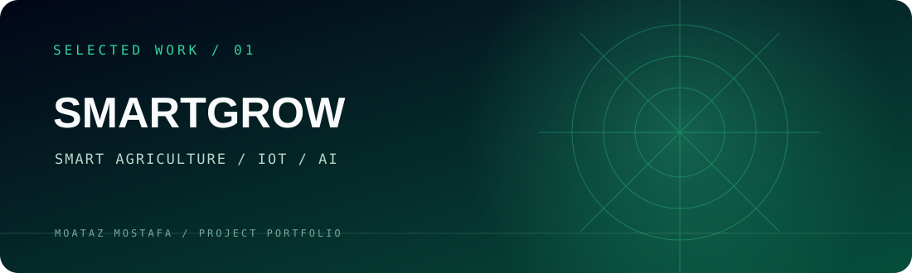
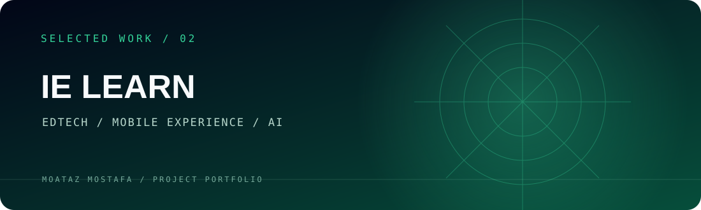
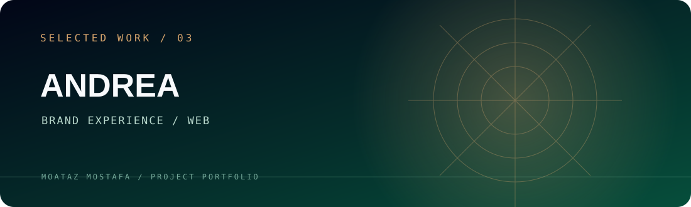
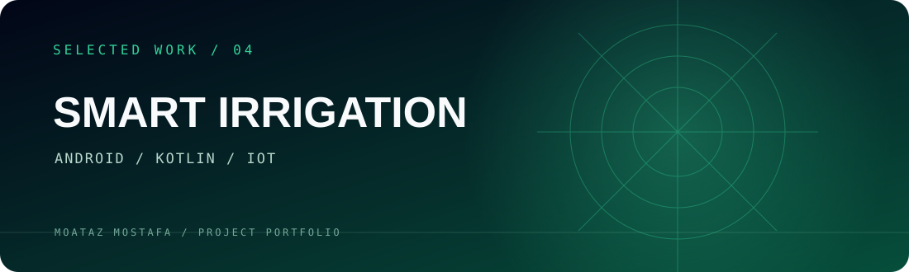

<div align="center">


<br/><br/>
<a href="mailto:motazelshirif211@gmail.com">CONTACT</a> &nbsp;·&nbsp;
<a href="https://www.linkedin.com/in/moataz-elshirif-11371423b/">LINKEDIN</a> &nbsp;·&nbsp;
<a href="https://github.com/moataz-mostafa">GITHUB</a>
</div>

<br/>

<div align="center">


</div>

---

<table>
<tr>
<td width="58%" valign="middle">

## Building useful things.

I'm **Moataz Mostafa**, a mobile application developer interested in turning practical ideas into reliable digital products.

My core focus is Flutter and Dart, with experience integrating REST APIs, Firebase, AI features, and hardware-connected systems.

I care about clear interfaces, maintainable code, and software that solves a real problem.

</td>
<td width="42%" valign="middle">

```text
MOATAZ / DEVELOPER_PROFILE

Mobile       Flutter · Dart
Backend      Firebase · REST
Android      Kotlin
Intelligence AI integration
Connected    IoT · Arduino

Based in     Cairo, Egypt
Education    MIS · 2024
```

</td>
</tr>
</table>

## Selected work

A few projects across mobile, education, connected systems, and digital experiences.

<a href="https://github.com/moataz-mostafa/smart-sys"></a>

**SmartGrow** · `IN DEVELOPMENT`

Smart agriculture concept connecting a mobile experience with sensor hardware and cloud services.

- Arduino Uno and sensor integration.
- Soil-condition monitoring.
- Firebase backend foundation.
- AI-assisted crop and market insights are part of the planned direction.

`Flutter` `Dart` `Firebase` `Arduino`

[Explore repository →](https://github.com/moataz-mostafa/smart-sys)

---



**IE Learn**

An education-focused mobile application designed around digital experiences for students and teachers.

- Teacher and student dashboards.
- Chat and communication features.
- Gemini AI chat integration.
- Authentication through REST APIs.

`Flutter` `Dart` `REST API` `Gemini`

---

<a href="https://github.com/moataz-mostafa/Andrea"></a>

**Andrea**

A restaurant brand website project focused on a distinctive visual identity and a modern digital presentation.

- Brand-led visual direction.
- Responsive website experience.
- Modern presentation for the restaurant concept.

`Web` `UI/UX`

[Explore repository →](https://github.com/moataz-mostafa/Andrea)

---



**Smart Irrigation System**

An Android and IoT project exploring the connection between mobile software and physical irrigation hardware.

- Arduino and sensor communication.
- Soil-moisture monitoring.
- Hardware-connected irrigation workflow.

`Kotlin` `Android` `Arduino`

---

## Technology

<div align="center">

</div>

---

## GitHub activity

<div align="center">


<br/><br/>

<br/>

</div>

---

## Current direction

<table>
<tr>
<td width="50%" valign="top">

**Engineering**

- Flutter and Dart
- Mobile application architecture
- State management
- API and Firebase integration

</td>
<td width="50%" valign="top">

**Exploration**

- AI-powered applications
- IoT-connected products
- Practical automation
- Product-focused development

</td>
</tr>
</table>

---

<div align="center">

### Have a product in mind?

I'm open to interesting mobile projects, collaboration, and development opportunities.

<a href="mailto:motazelshirif211@gmail.com"></a>

<br/><br/>
<sub>MOATAZ MOSTAFA · BUILDING WITH PURPOSE.</sub>

</div>
